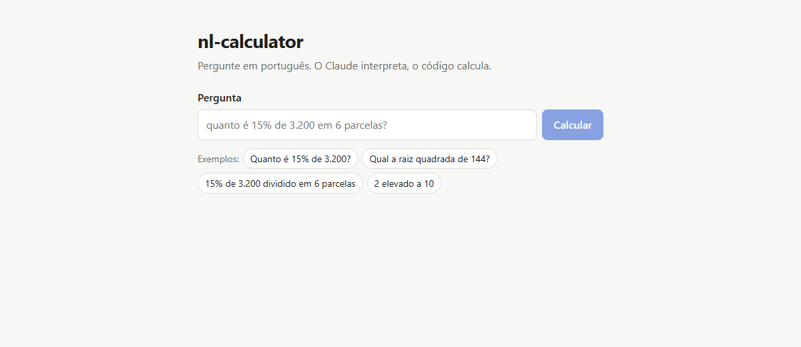

# nl-calculator

[](https://github.com/JooaBaarbosa/nl-calculator/actions/workflows/ci.yml)

**Calculadora em linguagem natural: o Claude interpreta, código determinístico calcula.**



Também funciona no terminal:

```
$ calc "quanto é 15% de 3.200 dividido em 6 parcelas?"
15% de 3.200 é 480; dividido em 6 parcelas, dá 80 por parcela.

Resultado: 80
Passos:
  3200 * 15 / 100 / 6 = 80
```

## Como funciona

```
navegador ──► página (React) ──┐
                               ├──► API ──► solver ◄──► Claude (ferramenta: calculate)
terminal ──► CLI ──────────────┘               │
                                               ▼
                                          evaluator ──► Decimal exato
```

1. O **solver** envia a pergunta ao Claude com uma única ferramenta, `calculate(expression)`.
2. O Claude traduz a pergunta para uma expressão (`3200 * 15 / 100 / 6`) e chama a ferramenta.
3. O **evaluator** calcula a expressão e devolve o resultado. Se a expressão for inválida,
   o erro volta para o Claude, que corrige e tenta de novo.
4. A resposta traz o resultado, cada expressão usada e uma explicação curta.

## Por que o LLM não faz a conta

LLMs erram aritmética. Aqui o modelo só **interpreta**; o número final vem sempre do código.
O campo `result` é o valor da última chamada bem-sucedida da ferramenta, nunca um número
extraído do texto do modelo.

A expressão gerada pelo modelo é tratada como **entrada não confiável**:

- **Sem `eval`.** O texto vira uma árvore com `ast.parse` (que não executa nada) e só uma
  lista fechada de nós é aceita: números, `+ - * / **`, sinal, parênteses e `sqrt()`.
  Qualquer outra coisa (`__import__`, variáveis, atributos, outras funções) é recusada.
- **Precisão exata.** Os números viram `Decimal`: `0.1 + 0.2` dá `0.3`.
- **Limites.** Tamanho da expressão, número de nós e expoente (±1000) são limitados;
  `9 ** 9 ** 9` vira erro em vez de travar o servidor.

## Rodando

Você precisa de uma chave da API da Anthropic. Clone e configure:

```bash
git clone https://github.com/JooaBaarbosa/nl-calculator.git
cd nl-calculator
cp .env.example .env   # preencha ANTHROPIC_API_KEY
```

### Com Docker (recomendado)

```bash
docker compose up --build
```

Abra `http://localhost:8000`. A página e a API sobem juntas, num container só.
A porta só aceita conexões da sua máquina, e a chave fica no `.env` (nunca entra na imagem).

### Sem Docker

Requisitos: [uv](https://docs.astral.sh/uv/) e Node 24.

```bash
cd web && npm ci && npm run build && cd ..   # compila a página para src/nl_calculator/static
uv sync
uv run uvicorn nl_calculator.api:app
```

Abra `http://127.0.0.1:8000`.

### Terminal (CLI)

```bash
uv sync
uv run calc "raiz quadrada de 144 mais 10% de 50"
uv run calc "2 elevado a 10" --json
```

### Desenvolvimento

```bash
uv run uvicorn nl_calculator.api:app --reload   # terminal 1: API em :8000
cd web && npm run dev                           # terminal 2: página em :5173, com recarga
```

O Vite repassa `/calculate` e `/health` para a API.

### API

```bash
curl -X POST http://127.0.0.1:8000/calculate   -H "Content-Type: application/json"   -d '{"question": "quanto é 15% de 3200?"}'
```

Documentação interativa em `http://127.0.0.1:8000/docs`.

| Situação | HTTP |
|---|---|
| Sucesso | 200 |
| Pergunta inválida, recusa do modelo, resposta cortada, tentativas esgotadas | 422 |
| Limite de requisições da Anthropic | 429 |
| Falha da Anthropic | 502 |
| Chave não configurada | 503 |

## Decisões técnicas

| Decisão | Por quê |
|---|---|
| Uma ferramenta que avalia expressões | Poucas chamadas ao modelo; o avaliador é testável sem LLM |
| Loop de tool calling escrito à mão | Deixa o protocolo explícito; sem depender de helper em beta |
| `Decimal` em vez de `float` | Resultado exato para dinheiro e porcentagem |
| Cliente da Anthropic injetado no solver | Todos os testes rodam sem rede e sem chave |
| `fallbacks: "default"` | Se o modelo recusar, a API tenta outro modelo automaticamente |
| Modelo e esforço configuráveis | `NLCALC_MODEL` e `NLCALC_EFFORT` sem mudar código |
| Uma imagem multi-stage | Node só compila a página; a imagem final tem só Python, sem root |
| Página servida pela própria API | Mesma origem: sem CORS, sem proxy, um processo só |
| Porta só em `127.0.0.1` | Ninguém na rede local gasta os seus créditos da Anthropic |

## Qualidade

- `pytest` com cobertura mínima de 90% (o avaliador tem 100%)
- `mypy --strict` e `ruff`
- Front-end: Vitest + React Testing Library (cobertura mínima de 90%), `tsc` em modo estrito e ESLint
- CI no GitHub Actions a cada push e pull request, com três jobs: Python, web e Docker
  (o job Docker sobe a imagem e confere a página e a API)

## Avaliação com o modelo real

`evals/questions.yaml` tem 15 perguntas com resposta conhecida, incluindo números no formato
brasileiro, porcentagens, raízes, uma pergunta que não é cálculo e uma divisão por zero.

```bash
uv run python evals/run.py   # usa a API de verdade (custa centavos)
```

## Licença

MIT
